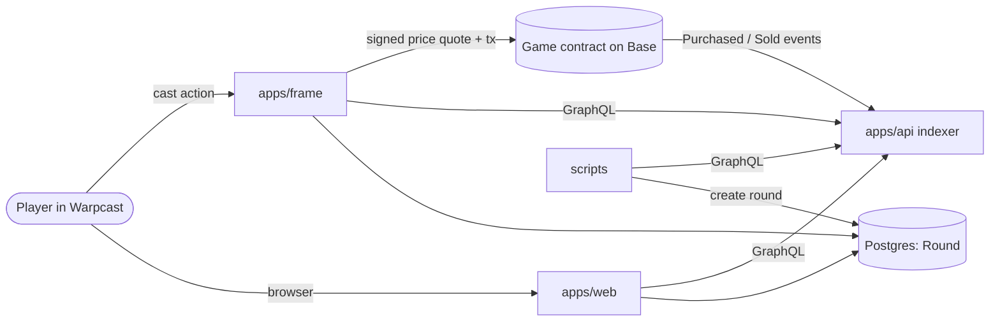

# cast.game

A prediction game for Farcaster channels: a stock market for casts. Players buy
"tickets" in casts they think will trend, and the creators and ticket holders of
the top three casts split the reward pool.

> **Status: retired.** This project was built between May and August 2024 and
> is no longer running or maintained. The code is published as a reference. The
> contracts are unaudited, the configured deployment is on the Base Sepolia
> testnet, and the apps depend on third-party APIs (Neynar, Airstack, Farcaster Frames v1) as they existed in
> mid-2024, so expect to adapt it before it runs again.

## How a round works

A round runs in one Farcaster channel for 48 hours.

1. **Trading (first 24 hours).** Players trigger a cast action on any cast
   created in the channel during the round. That opens a frame where they buy
   or sell tickets for the cast. Ticket prices follow a bonding curve, and casts
   from accounts with more followers start on a steeper curve.
2. **Waiting (next 24 hours).** Trading closes. Casts keep collecting
   engagement, measured by Airstack's cast score.
3. **Payout.** The three casts with the highest score win 50%, 30% and 20% of
   the pool. For each cast, 20% goes to the creator and 80% to the ticket
   holders, weighted by tickets held, with a bonus for the first buyer.

Every trade pays a fee to the protocol treasury, the channel host, the cast
creator and, if there is one, a referrer. Sellers get 80% of the curve price
back. Everything else stays in the contract and forms the reward pool.

## Architecture



Prices are computed off-chain. The frame calculates the price from the bonding
curve, signs `(castHash, creator, fid, amount, price, referrer, nonce)` with the
contract owner's key, and the player submits that quote with their transaction.
The contract only checks the signature, moves the fees and records the balance.

| Path | What it is | Stack |
| --- | --- | --- |
| [`apps/frame`](apps/frame) | The trading interface: a Farcaster frame and cast action that quotes prices and builds buy/sell transactions | Frog, viem, Neynar |
| [`apps/web`](apps/web) | Dashboard: casts in the current round, activity feed, a player's tickets | Next.js 14, Tailwind, Privy |
| [`apps/api`](apps/api) | Indexer: turns contract events into a GraphQL API of tickets, balances, transactions | Ponder |
| [`contracts`](contracts) | `Game.sol` (trading, fees, payout) and its tests | Foundry, OpenZeppelin |
| [`scripts`](scripts) | Operator scripts: create a round, compute the payout | Bun, Prisma |
| [`packages/shared`](packages/shared) | Code used by several of the above: contract ABI, bonding curve, indexer client, Prisma schema | TypeScript |

## Getting around the code

Good places to start reading:

- [`contracts/src/Game.sol`](contracts/src/Game.sol): the whole on-chain game in one contract
- [`packages/shared/src/pricing.ts`](packages/shared/src/pricing.ts): price tiers and the bonding curve
- [`apps/frame/api/index.tsx`](apps/frame/api/index.tsx): every frame screen and both transaction routes
- [`apps/api/src/Game.ts`](apps/api/src/Game.ts): how events become queryable state
- [`scripts/src/distribute.ts`](scripts/src/distribute.ts): how winners and payout amounts are computed

## Setup

Requires [Bun](https://bun.sh) and, for the contracts, [Foundry](https://book.getfoundry.sh).

```bash
git clone --recurse-submodules https://github.com/benbaessler/castgame.git
cd castgame
bun install
bun run db:generate
```

Each package has a `.env.sample` listing the variables it reads; copy it to
`.env` and fill it in. Per-package commands are in each package's README.

The contracts build and their tests pass (`forge test`), and every TypeScript
package typechecks. The apps themselves have not been run end to end since the
project was retired.

## History

This repository merges five repositories that used to live in a separate GitHub
organization (`web`, `frame`, `api`, `contracts`, `scripts`). Their full commit
history is preserved under the corresponding folders.

## License

[MIT](LICENSE)
